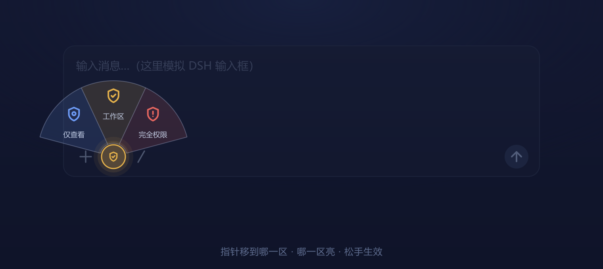
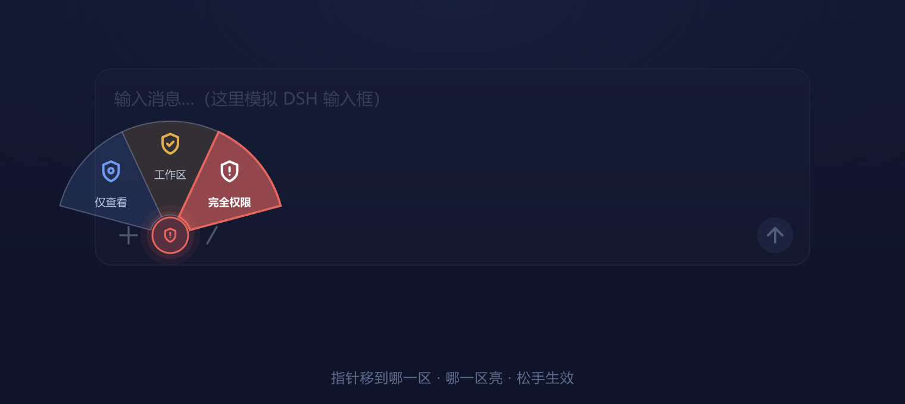

# 权限扇形 · Permission Fan

把 DeepSeek Harness 输入框左下角的权限切换，从「点开下拉菜单 → 找到那一项 → 再点一下」变成**一次手势**：按住圆钮、向上拖出扇形、松手即生效。

🎬 **视频讲解**：[B站 · BV1ApW16bEwX](https://www.bilibili.com/video/BV1ApW16bEwX)

<p align="center">
  
</p>

<p align="center">
  
</p>

---

## 它解决什么

用 AI 助手动文件时，权限切换是高频但琐碎的操作。官方控件是一个下拉菜单：点开 → 在三项里找 → 再点一下。三档之间来回切，一天几十次，每次都会打断当下的思路。

这个插件把三档权限压成一个 150° 的扇形，一次「按住—拖动—松手」完成切换，不再需要瞄准菜单项。

## 怎么用

1. 输入框左下角有一个圆形按钮，颜色跟着当前权限走：**蓝 = 仅可查看**、**金 = 工作区**、**红 = 完全权限**
2. **按住**它，扇形向上张开，三等分
3. 把指针移进某一区——该区填充加深、描边点亮，图标和文字转白
4. **松手**生效；指针滑出扇区、按 `Esc`、或松手时不在任何区内，都视为取消，权限不变

三个区各自带图标和小字，不会认错。

## 安装

### 前置条件

DeepSeek Harness **0.2.x**（插槽名与命令通道基于 0.2.2-rc.1 验证）。

### 1. 装插件

```bash
# 本地目录
plugin_manager install_bundle /path/to/dsh-permission-fan

# 或从 GitHub
plugin_manager install_bundle github:<你的用户名>/dsh-permission-fan
```

### 2. 让官方客户端控件让位 ⚠️

`conversation.input.permission` 是**单值插槽**，只允许一个注册者。必须先把官方的客户端控件禁用，否则两个插件抢同一个插槽，启动会失败。

在 profile 的 `cordis.patch.yml` 末尾加上：

```yaml
- id: ui-permission
  disabled: true
```

> 注意：禁用的只是客户端 UI（`ui-permission`）。host 侧的权限预设和 `/permission` 命令不受影响。

### 3. 重启客户端

客户端插件需要重启才会重新加载。

## 设计细节

- **扇区几何**：总张角 150°，三等分每区 50°，外径 96px、内圈 17px，圆心就是那个圆钮
- **配色**：`#6D9BF5`（仅可查看）/ `#E3B04B`（工作区）/ `#E5665F`（完全权限）
- **状态读取**：插槽 props 的 `useProjection("permissions")`
- **状态写入**：`ctx.sessions.binding(sessionId).session.command("/permission <值>")` —— 与官方客户端同一条命令通道，不是模拟点击
- **浮层**：`createPortal` 到 `document.body`（输入框有裁切，浮层必须出层）
- **失败降级**：拿不到权限投影时不渲染，绝不留下一个点不动的空按钮

参数都集中在 `lib/client.js` 顶部，想改张角、半径、颜色改几个常量即可。

## 目录结构

```
.
├─ lib/
│  ├─ index.js          # 宿主半边（只为让包成为 loader 一行）
│  └─ client.js         # 客户端半边：圆钮 + 扇形 + 手势
├─ locale/
│  ├─ zh.json           # 插件管理器里显示的名称与描述
│  └─ en.json
├─ preview/
│  ├─ preview.html      # 可交互原型（浏览器直接打开）
│  ├─ render.mjs        # 效果图生成脚本（sharp）
│  └─ shots/            # 效果图
├─ cordis.patch.yml
├─ icon.svg
└─ package.json
```

## 已知限制

- 只替换**当前会话**的权限控件；`/permission` 斜杠命令的弹窗、以及「设置 → 通用 → 权限」的默认值行会随着官方客户端控件一起被禁用
- 宿主需要提供 `permissions` 投影（老版本没有时控件不渲染）
- 完全权限**没有二次确认**——松手即生效。这是刻意的取舍，请确认你接受再装

## 兼容性

| DSH 版本 | 状态 |
|---|---|
| 0.2.2-rc.1 | 已验证 |

## License

MIT
